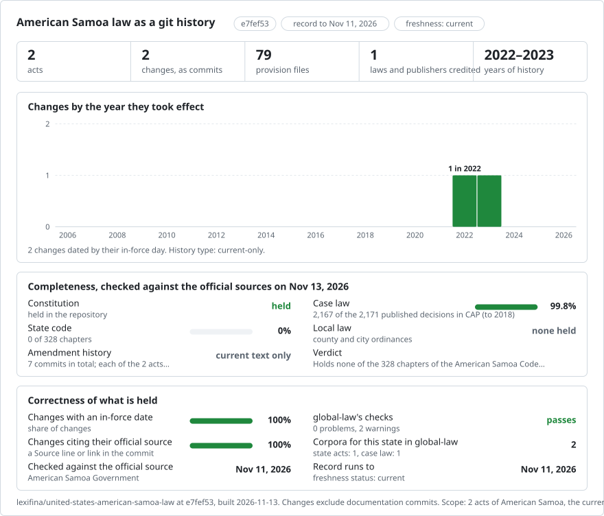

<picture>
<source media="(prefers-color-scheme: dark)" srcset="data/effort-dark.svg">

</picture>

# American Samoa: law history in git

Official American Samoa texts, part of [Lexifina global law](https://github.com/lexifina/global-law).

| Folder | Act | Versions | History |
| --- | --- | ---: | --- |
| `constitution/` | Revised Constitution of American Samoa | 1 | Baseline derived from the Government's marked draft dated 6 September 2022; subsequent constitutional proposals are not included |
| `workmen-compensation-travel-reimbursement/` | Reimbursement Policy for Other Allowable Travel Expenses | 1 | Commission revisions approved 7 December 2022, effective 9 January 2023 |
| `asac-02-03/` | American Samoa Administrative Code, Title 2, Chapter 3 – Government Records Management | 1 | 2024 Code edition; latest source effective date 1987-08-04 |
| `asac-03-01/` | American Samoa Administrative Code, Title 3, Chapter 1 – Election Contributions and Expenses | 1 | 2024 Code edition; latest source effective date 1985-05-02 |
| `asac-05-02/` | American Samoa Administrative Code, Title 5, Chapter 2 – Economic Development Planning Commission | 1 | 2024 Code edition; latest source effective date 1987-10-12 |
| `asac-06-02/` | American Samoa Administrative Code, Title 6, Chapter 2 – Rental Space of Market Place for Bingo Games | 1 | 2024 Code edition; latest source effective date 1983-07-01 |
| `asac-13-01/` | American Samoa Administrative Code, Title 13, Chapter 1 – Student Financial Aid | 1 | 2024 Code edition; latest source effective date 1988-05-25 |
| `asac-13-02/` | American Samoa Administrative Code, Title 13, Chapter 2 – Tuition Rates and Fees at American Samoa Community College | 1 | 2024 Code edition; latest source effective date 1983-12-28 |
| `asac-19-01/` | American Samoa Administrative Code, Title 19, Chapter 1 – Commercial Transportation | 1 | 2024 Code edition; latest source effective date 2023-07-19 |
| `asac-19-02/` | American Samoa Administrative Code, Title 19, Chapter 2 – Commercial Transportation Chapter 2 | 1 | 2024 Code edition; latest source effective date 2023-07-19 |

The Constitution text comes from the American Samoa Government's 2022 marked draft. Proposed underlined additions are excluded from the existing baseline. Later referendum approvals and amendment history are not included. This record does not establish that the baseline remains the current Constitution.

The Workmen's Compensation Commission's notice dated 28 December 2022 supplies the revised reimbursement rules and explicitly states their effective date. The reimbursement table preserves its combined cells. Earlier rules are not included.

The Code Annotated, other executive orders, regulations and court decisions are not included. Official scanned documents are not transcribed in this record. These records are not official publications.

Sources: [American Samoa Government Constitution draft](https://www.americansamoa.gov/_files/ugd/4bfff9_637c7079564f4812ae2c848e48753e7d.pdf) and [Workmen's Compensation Commission notice](https://www.americansamoa.gov/_files/ugd/4bfff9_1bc87458e18b4a19a6a845ac583b39cd.pdf).

Eight chapters from the Secretary of American Samoa's official 2024 Administrative Code edition are included. Each preserves the complete chapter, its front matter and history notes in units matching the source PDF pages. Dates follow the chapter's latest express effective-date notes; they are not the publication or retrieval date of the compilation. Earlier wording has not been reconstructed. Other chapters, image annexes and the filed rule documents are not included. The public-law repository describes its own listing as incomplete.

Source: [Secretary of American Samoa repository](https://www.osas.as/services-4).
